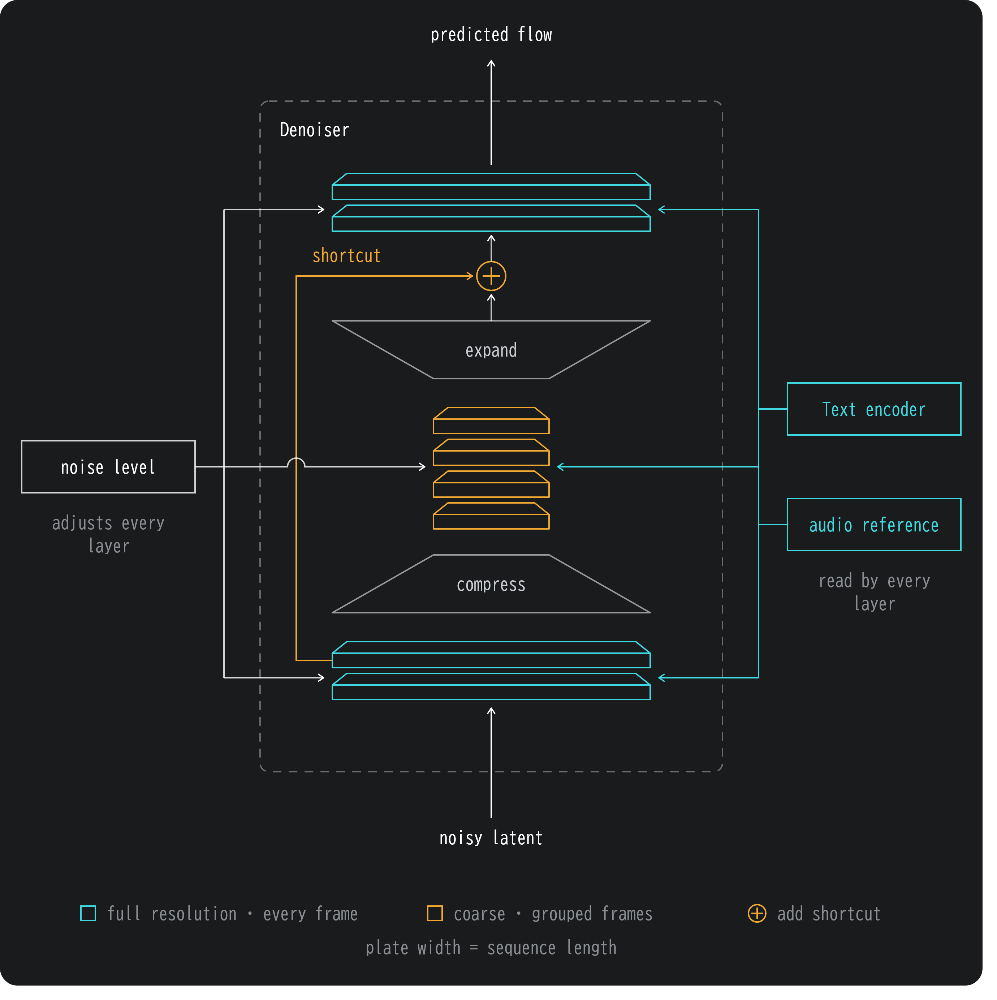

[English](README.md) | 日本語

# Nichijou 500M

Nichijouは、日本語の音声と会話全体をエンドツーエンドで生成できる、強力なhourglass型の拡散Transformerです。

## 推論

[inference_cleaned.ipynb](inference_cleaned.ipynb)を参照してください。

推論の前に、[Hugging Faceからモデルとコーデックのファイル](https://huggingface.co/Respair/Nichijou_TTS/tree/main/assets)をダウンロードして、このリポジトリの`assets/`フォルダに配置してください。

入力の書き方や対応タグについては、[使い方とポイント（英語）](docs/usage.md)にまとめています。

## 学習

[学習とデータセットのガイド（英語）](docs/training.md)を参照してください。

## アーキテクチャと学習

hourglass型のDiTを採用し、計算の大部分を時間方向の解像度を半分にした状態で行います。これにより、学習コストを抑えながら、より大きなバッチを使えます。学習対象は、Fishコーデックの量子化後の潜在表現にPCAを適用したものです。

H100を1枚使い、1週間で計52万ステップ学習しました。学習には、通常のTTS、音声の続きを生成するprefix-conditioned generation、途中の区間を埋めるinfillingの3つの目的を使っています。infillingで学習しているので、音声編集もできるかもしれませんが、そこはまだ評価していません。

  

## データ

学習データの中心は、アニメのセリフではなく、普段の生活で話される日本語の会話です。推定で11万〜15万時間ほどあり、その多くは、現在開発中の専用パイプラインを通して内部で収集・整理したものです。コードスイッチングに対応するため、約2万2千時間の英語も混ぜています。

日本語の書き起こしにはIPAを使っているので、読みが曖昧な漢字も含め、発音を直接調整できます。

## ベンチマーク

**Joyo Kanji Yomi Benchmarkの全13,095件**での結果です。EMAの20,000ステップ時点の重みを使い、参照音声なし、サンプリング32ステップ、ガイダンス3で生成しました。数値は低いほど良いです。

| Nichijouの設定 | 対象箇所のKana-CER | 文全体のKana-CER | テキストCER |
|---|---:|---:|---:|
| ベースライン（標準の簡易フォネマイザー） | 4.74% | 2.38% | 5.62% |
| IPA修正後 | 1.19% | 2.12% | 5.61% |

修正後の結果では、読みを間違えたレコードの発音を手動で修正しています。漢字の読みが間違っていてもモデル側で補ってくれることはありますが、できるだけ正確に読ませたいなら、自分でG2Pパイプラインを整える価値はあると思います。

## 利用について

Nichijouは声を模倣できます。利用する地域の法律に従い、他人の声を模倣する場合は、本人の許可を得てください。無断でのなりすましは禁止です。

# 補足

このプロジェクトは、あくまで実験として扱ってください。公開しているチェックポイントだけで、本格的な用途に使えるかどうかは分かりません。

ほかにも、もっと規模の大きいプロジェクトをいくつか進めていたのですが、残念ながら今の事情では、これ以上ひとりで抱えるのは難しくなるかもしれません。
なので、手伝ってくれる方や、場合によっては引き継いでくれる方がいれば、気軽に連絡してください。
