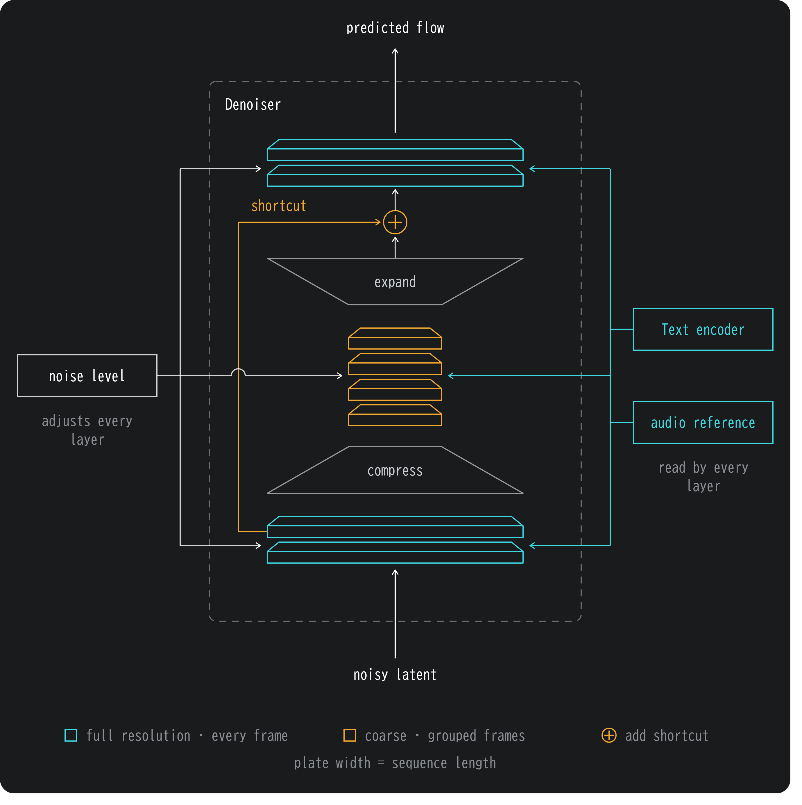

English | [日本語](README.ja.md)

# Nichijou 500M

Nichijou is an hourglass diffusion transformer, capable of generating Japanese speech and end-to-end conversations.

## Inference

See [inference_cleaned.ipynb](inference_cleaned.ipynb).

Download the [model and codec assets from Hugging Face](https://huggingface.co/Respair/Nichijou_TTS/tree/main/assets) into this repository's `assets/` folder before running the notebook.

See [usage and tips](docs/usage.md) for input formatting and supported control tags.

## Training

See the [training and dataset guide](docs/training.md).

## Architecture and training

The hourglass DiT performs most of its computation at half the temporal resolution, reducing training cost and allowing larger batches. Its targets are PCA-projected, post-quantization Fish codec latents.

The model was trained on a single H100 for one week, totaling 520,000 steps across full TTS, prefix-conditioned generation, and infilling objectives. The infilling objective may also support speech editing, though that capability has not been evaluated here.

  

## Data

Training primarily used everyday Japanese conversations rather than anime speech: an estimated 110,000–150,000 hours, much of it curated internally through a dedicated pipeline under development. Around 22,000 hours of English were mixed in to support code-switching.

Japanese transcripts use IPA so pronunciations, including ambiguous kanji readings, can be adjusted directly.

## Benchmark

Results on the **13,095-item Joyo Kanji Yomi Benchmark**, using EMA step 20,000, no reference audio, 32 sampling steps, and guidance 3. Lower is better.

| Nichijou run | Target Kana-CER | Sentence Kana-CER | Text CER |
|---|---:|---:|---:|
| baseline (default simple phonemizer) | 4.74% | 2.38% | 5.62% |
| With IPA corrections | 1.19% | 2.12% | 5.61% |

The correction pass used manually corrected readings for failed records. the model can still correct on its own on incorrect Kanjis, but for the utmost accuracy you can invest in your own G2P pipeline.

## Responsible use

Nichijou can imitate voices. Use it in accordance with applicable law and obtain permission before imitating another person's voice. Unauthorized impersonation is prohibited.
treat this project as an experiment, provided checkpoints may or may not be suitable for any serious work on their own.

# Footnote

I was also working on a few things that are much larger in scope; but unfortunately due to my circumstances I may not be able to manage them anymore alone.
so if there's anyone (preferably) in Japan willing to help (or maybe pick them up? depends) feel free to reach me.

